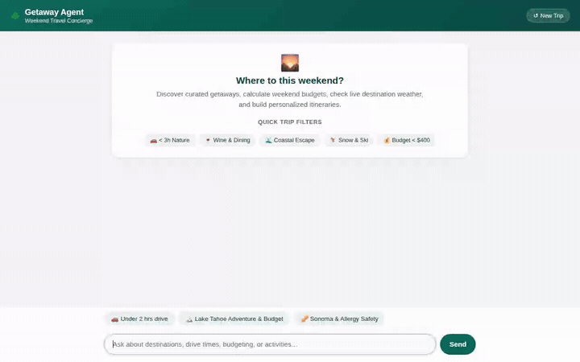

# 🌲 Getaway Agent — Weekend Travel Concierge

A conversational travel concierge built with Google's **Agent Development Kit (ADK)** and `agents-cli` on **Agent Platform**, designed to help busy travelers discover, plan, and budget personalized weekend getaways.

The agent features persistent cross-session memory (tracking user preferences and allergy constraints), structured destination storage, dynamic live weather integration, trip budget estimation, automated itinerary visual postcard and video creation, and rich A2UI cards.

<div align="center">



</div>

---

## 🌟 What the Agent Does

Based directly on the implementation in [`app/agent.py`](app/agent.py), Getaway Agent handles multi-turn travel planning workflows:

- **Allergy & Preference Memory Tracking**: Persistently tracks user constraints across sessions—most crucially dietary, pet, and environmental allergies—ensuring safe dining and lodging recommendations.
- **Curated Weekend Curation**: Filters weekend destinations from Firestore by drive-time threshold, maximum budget, and travel vibe (relaxation, nature, romantic, adventure).
- **Interactive A2UI Surface Rendering**: Generates clean, structured A2UI card layouts with multi-line destination overviews, drive metrics, and highlight itineraries.
- **Multimodal Visual Generation**:
  - **Scenic Postcards**: Generates travel postcards and visuals via `gemini-3.1-flash-lite-image`, saving them as ADK runtime artifacts and uploading to public Cloud Storage for instant display in A2UI cards.
  - **Cinematic Destination Video**: Generates short video clips using Google's Omni model (`gemini-omni-flash-preview`), saving to artifacts and publishing to Cloud Storage.
- **Live Weather Verification**: Fetches real-time temperature, apparent feels-like temperature, wind speed, and conditions via Open-Meteo.
- **Destination Context & History**: Retrieves factual background summaries from Wikipedia for points of interest.
- **Trip Budget Breakdown**: Computes estimated fuel costs, lodging tiers (budget, moderate, luxury), and activity costs with split-cost calculations per traveler.
- **Python Code Sandbox Execution**: Runs dynamic logic and custom calculations via Agent Engine sandbox code execution.

---

## ☁️ Google Cloud Services & Tool Integrations

Only the services and tools actively wired in [`app/agent.py`](app/agent.py) and [`agents-cli-manifest.yaml`](agents-cli-manifest.yaml):

| Service / Tool | Component | Role in Agent |
|---|---|---|
| **Vertex AI Reasoning Engine** | `gemini-3.6-flash` | Primary reasoning and planning model (`root_agent`) |
| **Agent Platform Memory Bank** | `PreloadMemoryTool` & `generate_memories_callback` | Cross-session memory recall and automatic memory extraction |
| **Cloud Firestore** | `list_destinations`, `get_destination_details`, `save_destination` | Destination catalog storage, querying by drive time, budget, and vibe |
| **Cloud Storage (GCS)** | `generate_destination_image`, `generate_destination_video` | Public asset hosting for generated postcard images and video MP4s |
| **Gemini Image Generation** | `gemini-3.1-flash-lite-image` | High-quality postcard imagery generation in `global` region |
| **Gemini Video Generation** | `gemini-omni-flash-preview` | Short destination video generation in `global` region |
| **A2UI & A2A Protocol** | `a2ui_callback`, `A2uiSchemaManager`, `a2a-sdk` | Rich UI card components and protocol streaming to chat clients |
| **Agent Engine Code Sandbox** | `AgentEngineSandboxCodeExecutor` | Secure cloud-sandboxed Python execution environment |
| **External APIs** | Open-Meteo & Wikipedia APIs | Real-time weather lookup and destination background knowledge |

*(Note: Vertex AI RAG Engine corpus was explored in initial planning but retrieval is currently handled through Firestore destination querying and live API tools.)*

---

## 🏗️ Project Architecture

```text
getaway-agent/
├── app/
│   ├── agent.py                 # Core ADK agent, tools, callbacks, and sandbox wiring
│   ├── a2ui_utils.py            # A2UI callback and surface transformation helpers
│   ├── instruction.txt          # Agent role guidelines & A2UI layout constraints
│   ├── fast_api_app.py          # FastAPI backend server
│   └── app_utils/               # A2A protocol and reasoning engine adapters
├── frontend/
│   ├── main.py                  # FastAPI proxy communicating over A2A protocol
│   └── static/
│       └── index.html           # Branded chat UI with quick prompt chips & A2UI renderer
├── demo/                        # Playwright automated demo scripts and media assets
├── assets/
│   └── getaway_agent_demo.gif   # Looping demo screen capture
├── agents-cli-manifest.yaml     # Agent deployment specification
└── pyproject.toml               # Python dependencies and package definition
```

---

## 🚀 Running Locally

### 1. Prerequisites

- Python 3.11+
- `uv` package manager (`curl -LsSf https://astral.sh/uv/install.sh | sh`)
- Authenticated Google Cloud credentials:
  ```bash
  gcloud auth login
  gcloud auth application-default login
  ```

### 2. Run the Agent Playground

To interact directly with the agent using the ADK development playground:

```bash
cd getaway-agent
uv sync
uv run agents-cli playground
```

### 3. Run the Custom Frontend

The frontend consists of a FastAPI proxy communicating over the A2A protocol to the deployed Agent Runtime engine:

```bash
cd getaway-agent/frontend

# Install dependencies
uv venv .venv
uv pip install -r requirements.txt

# Start the frontend server (ensure AGENT_ENGINE_RESOURCE_NAME is set)
export AGENT_ENGINE_RESOURCE_NAME="<your-agent-engine-resource-name>"
export AGENT_DIRECTORY="app"
export PORT=8080

.venv/bin/python main.py
```

Visit the frontend server in your browser on port `8080` to interact with the branded Getaway Concierge chat UI.

---

## 🧪 Testing

Run unit and integration tests:

```bash
cd getaway-agent
uv run pytest tests/
```
